# SlashMount

An RTS with really custom units: build a chassis, MOUNT modules onto it!

**[Download the latest version](https://github.com/TachyonWolf/SlashMount-Releases/releases/latest)**

## Screenshots

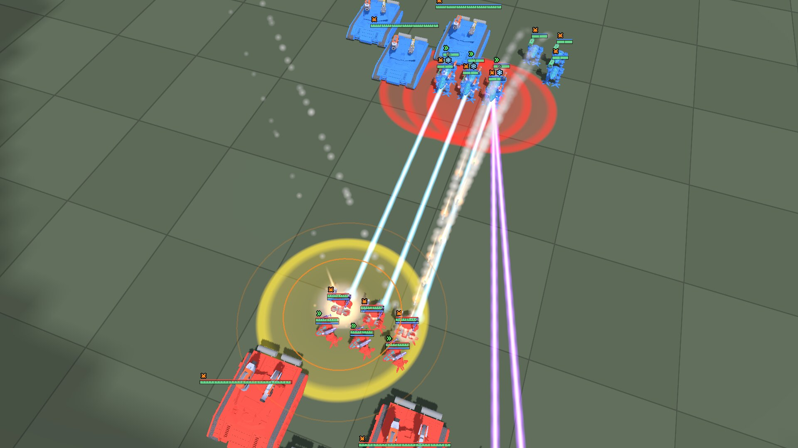

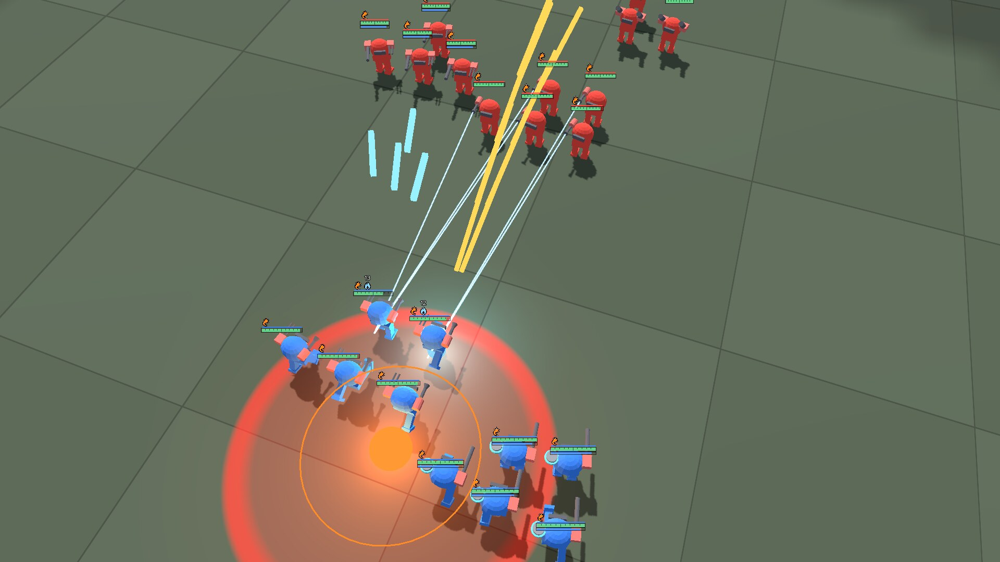

**AI armies at war.** Two AI players run their own units.

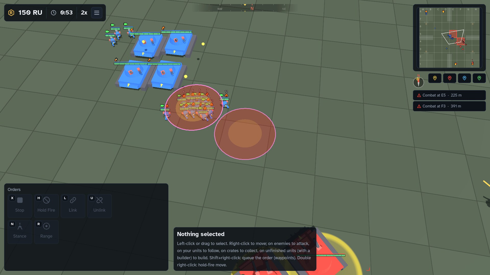

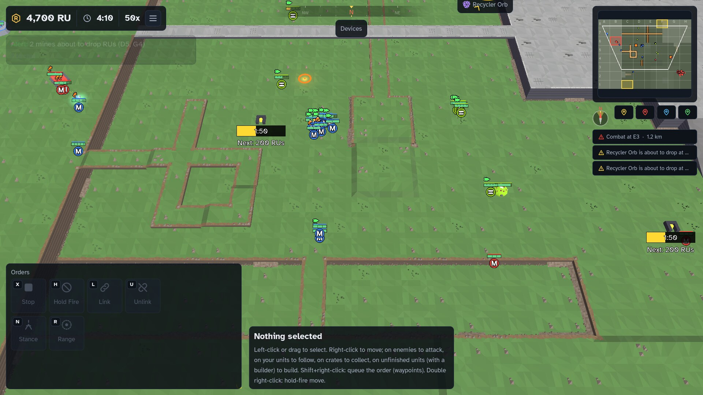

**Build your units.** Pick a chassis, then mount modules on it.

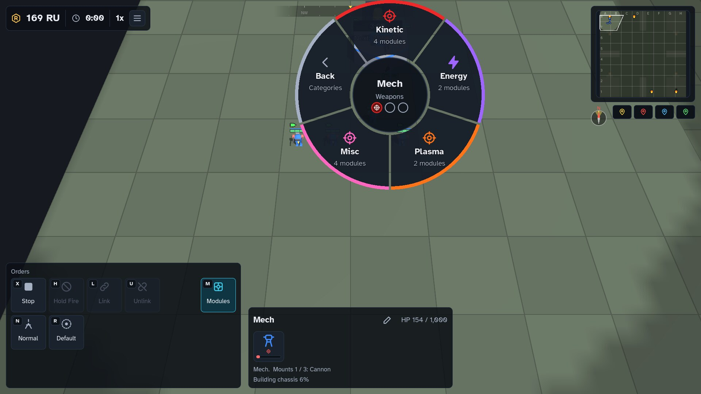

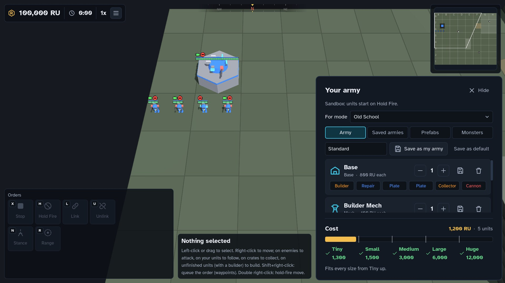

**Make your own maps.** Paint the ground, place things, and add triggers.

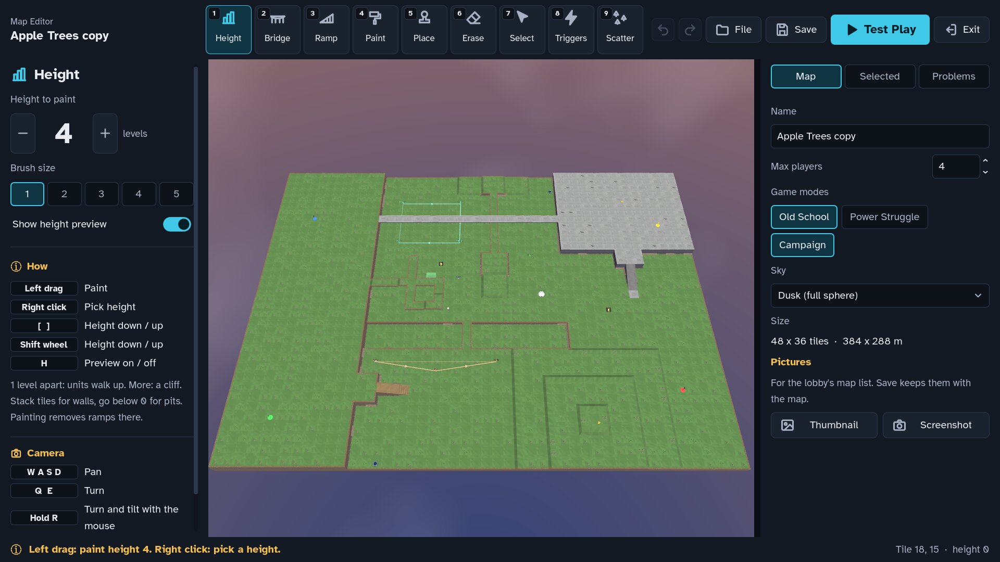

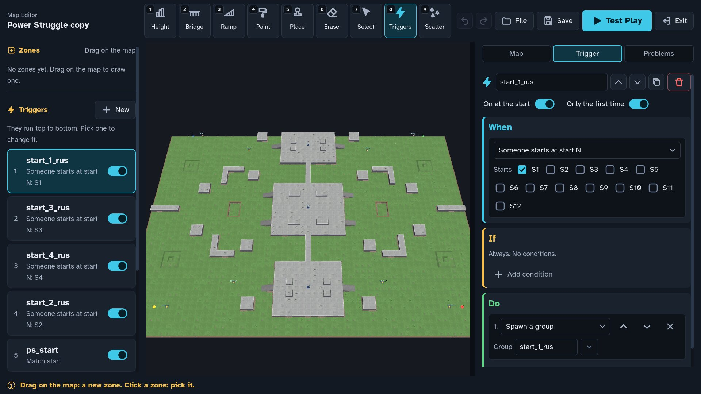

**Menus**

| | |
|---|---|
| 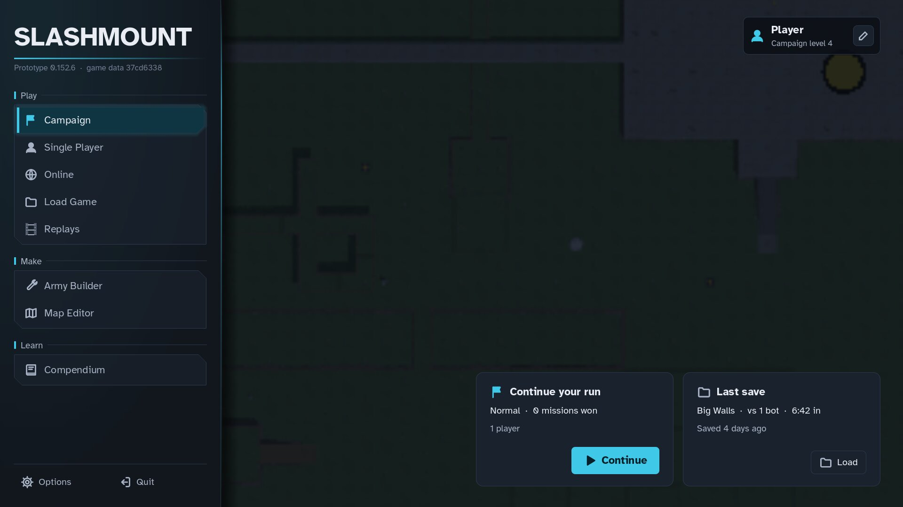 | 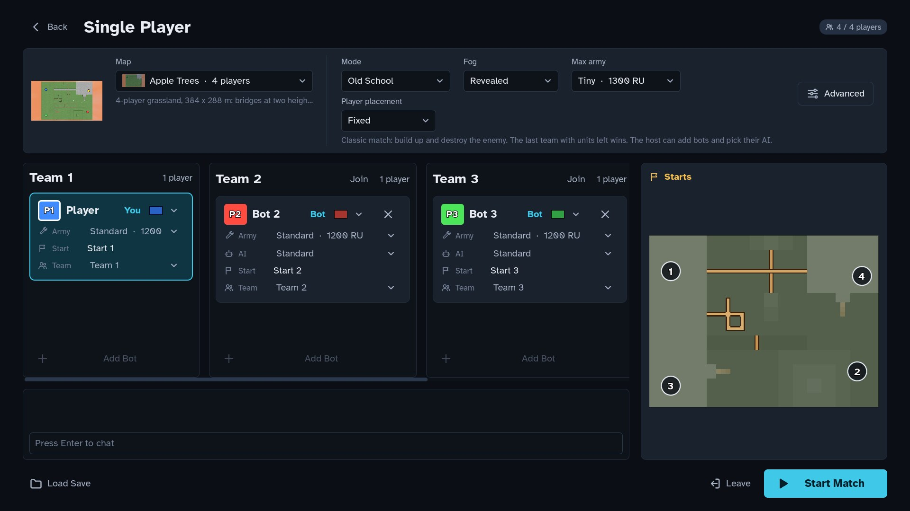 |
| 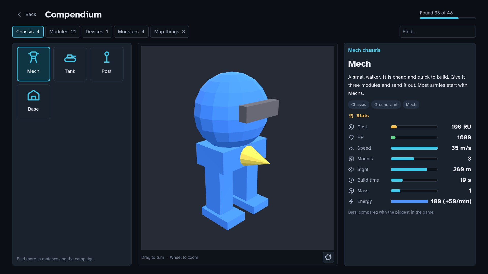 | |

## How to play

1. Open the link above.
2. Under **Assets**, pick the zip for your system:
   - Windows: `SlashMount-<version>-windows.zip`
   - Linux: `SlashMount-<version>-linux.zip`
3. Unzip it anywhere.
4. Run `SlashMount.exe` (Windows) or `SlashMount.x86_64` (Linux).

Windows may warn that the app is unknown. Click **More info**, then **Run anyway**.

## Credits

The people whose art, sound and fonts the game uses: [CREDITS.md](CREDITS.md).

## Status

Early multiplayer prototype. Most art is placeholder.

The game's source code is private. This page only has the downloads.
